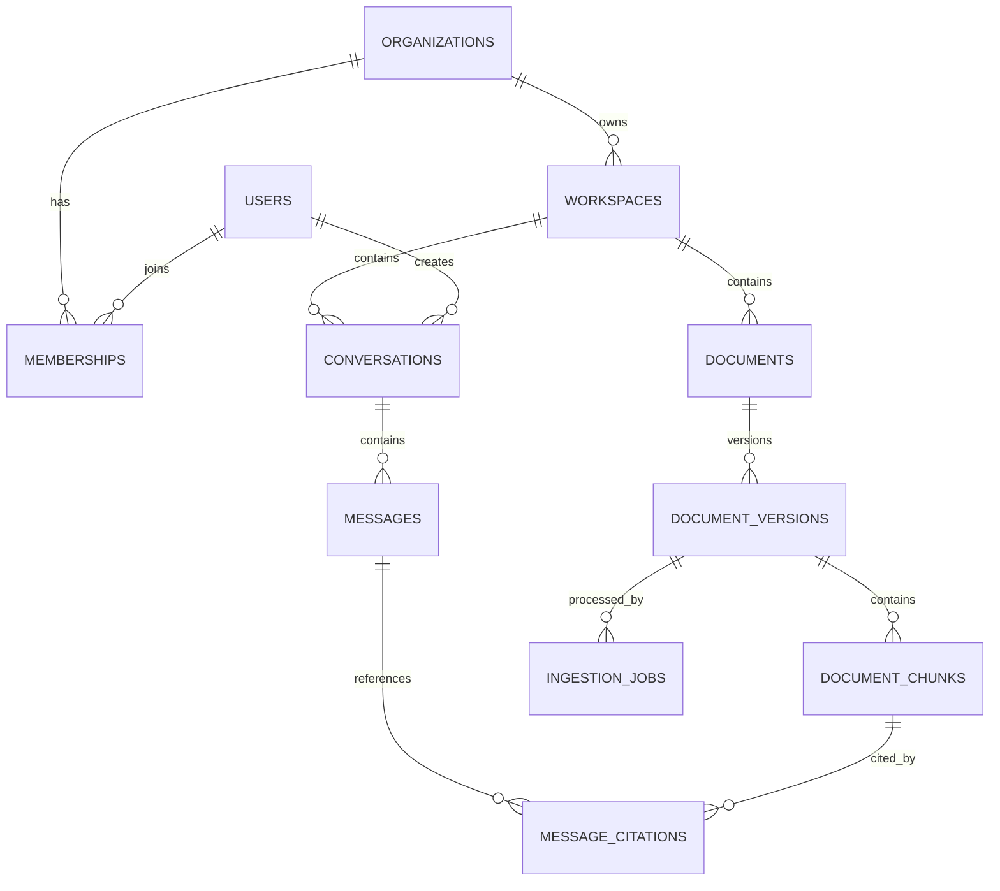
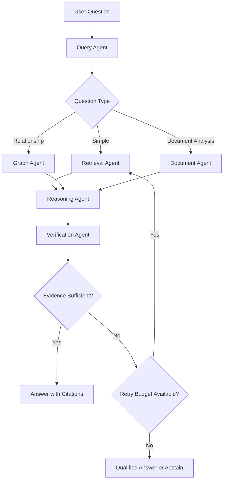

# OMNIMIND AI

Product Requirements Document (PRD) & Technical Implementation Plan

(Production-oriented) (Individual development) (Version 1.0)

**OMNIMIND AI** is an enterprise knowledge intelligence platform powered by Advanced RAG, Graph RAG, and multi-agent AI. It enables organizations to securely search, analyze, and reason across documents and connected knowledge sources.

This plan targets a deployable, maintainable application rather than a demonstration chatbot. Because development is individual, the strategy is to build a reliable core first, then introduce advanced capabilities incrementally.

## 1. Product vision and objectives

**Problem:** Enterprise knowledge is distributed across documents, departments, repositories, and communication platforms. Employees struggle to locate accurate information, compare conflicting sources, and verify answers.

**Solution:** A centralized AI knowledge platform that retrieves authorized information, generates grounded answers, and supports complex cross-document reasoning.

### Primary users

| Role | Capabilities |
|--------|--------|
| Organization Admin | Manage organization, users, permissions, integrations |
| Knowledge Manager | Upload, organize, update, and review knowledge |
| Employee | Search authorized knowledge and ask questions |
| Platform Operator | Monitor infrastructure and system reliability |

### Success criteria

- Every factual answer includes supporting source citations.
- Unauthorized documents never appear in retrieval results or generated responses.
- Document updates and deletions propagate to search indexes.
- Users can ask follow-up questions without losing relevant conversation context.
- Retrieval quality, answer grounding, latency, and costs are measurable.
- The system can recover from ingestion failures without corrupting indexed data.

## 2. Product scope

**Version 1 — Production foundation**

Organization workspaces, authentication, document ingestion, hybrid RAG, citations, conversations, RBAC, audit logging, monitoring, and deployment.

**Version 2 — Advanced intelligence**

Knowledge graph retrieval, multi-agent reasoning, document comparison, query decomposition, and answer verification.

**Version 3 — Enterprise expansion**

External integrations, synchronization, advanced administration, organization analytics, and additional deployment options.

Initially exclude autonomous document modifications, unsupervised external actions, enterprise billing, and a large marketplace of integrations. These would distract from the core engineering requirements.

## 3. Functional requirements

| ID | Requirement | Priority |
|--------|--------|--------|
| FR-01 | User authentication and sessions | P0 |
| FR-02 | Organization and workspace isolation | P0 |
| FR-03 | Role-based access control | P0 |
| FR-04 | PDF, DOCX, TXT, Markdown ingestion | P0 |
| FR-05 | Asynchronous document processing | P0 |
| FR-06 | Hybrid vector and keyword search | P0 |
| FR-07 | Source-grounded conversational answers | P0 |
| FR-08 | Document update, reindex, and deletion | P0 |
| FR-09 | Audit logs and operational monitoring | P0 |
| FR-10 | Query decomposition and reranking | P1 |
| FR-11 | Graph-based knowledge retrieval | P1 |
| FR-12 | Multi-agent document comparison | P1 |
| FR-13 | Evidence and citation verification | P1 |
| FR-14 | External source connectors | P2 |
| FR-15 | Analytics and usage reporting | P2 |

P0 means required for the first deployable release; P1 and P2 are subsequent enhancements.

## 4. Detailed system architecture

**React + TypeScript Frontend**

Chat · Document Library · Workspaces · Admin

**API Gateway / FastAPI**

Auth · Tenant Context · Authorization · Rate Limits

Background Processing

Celery + Redis · Parsing · Embeddings · Indexing · Graph Extraction

### Architectural decisions

Use a **modular monolith** initially. FastAPI modules should be separated by domain, but deployed as one backend service plus independent background workers.

This avoids unnecessary microservice complexity while maintaining clear module boundaries.

| Component | Choice | Reason |
|--------|--------|--------|
| API | FastAPI | Async support, typing, validation |
| ORM | SQLAlchemy 2 | Mature relational persistence |
| Migrations | Alembic | Versioned schema changes |
| Jobs | Celery + Redis | Retryable asynchronous processing |
| Vector search | Qdrant | Metadata filtering and vector retrieval |
| Graph | Neo4j | Entity and relationship traversal |
| Embeddings | BGE-M3 | Multilingual embedding support |
| Orchestration | LangGraph | Stateful, bounded agent workflows |
| Storage | S3-compatible | Durable document object storage |

## 5. Database design

PostgreSQL is the authoritative database for users, access permissions, documents, processing states, conversations, and audit records.

### Core relational schema

| Table | Important fields |
|--------|--------|
| `organizations` | id, name, slug, status, created_at |
| `users` | id, email, password_hash, status, created_at |
| `memberships` | id, organization_id, user_id, role |
| `workspaces` | id, organization_id, name, created_at |
| `workspace_members` | workspace_id, user_id, role |
| `documents` | id, organization_id, workspace_id, title, status, current_version_id |
| `document_versions` | id, document_id, version_number, storage_key, checksum, created_at |
| `document_chunks` | id, version_id, chunk_index, content, page_number, metadata |
| `ingestion_jobs` | id, document_version_id, status, attempts, error_code |
| `conversations` | id, organization_id, workspace_id, user_id, created_at |
| `messages` | id, conversation_id, role, content, created_at |
| `message_citations` | id, message_id, chunk_id, document_version_id |
| `audit_events` | id, organization_id, actor_id, action, resource_id, created_at |

All identifiers should use UUIDs. Add foreign keys, uniqueness constraints, timestamps, and indexes on organization, workspace, document, and processing status fields.

For permissions, use an explicit `document_grants` table if documents can be shared beyond inherited workspace access.

### Data relationships



**Important:** Qdrant and Neo4j are derived indexes, not the source of truth. Index records should reference canonical PostgreSQL IDs. Reindexing must be possible without losing the original documents or their permissions.

## 6. Advanced RAG pipeline

### Ingestion pipeline

1. Validate file size, type, organization quota, and upload authorization.
2. Store the original file in private object storage.
3. Create a document version and ingestion job.
4. Parse text, tables, headings, and page references.
5. Normalize content and remove redundant boilerplate.
6. Split into structure-aware chunks with configurable overlap.
7. Generate embeddings in batches.
8. Index authorized metadata and vectors.
9. Build or refresh keyword search indexes.
10. Atomically mark the new version searchable after required indexes succeed.

For the first release, use PostgreSQL full-text search for BM25-like keyword retrieval only if you implement a proper ranking strategy; otherwise use a dedicated BM25 engine or library. PostgreSQL's native full-text ranking is not identical to BM25.

### Retrieval configuration

Start with configurable experimental defaults:

| Parameter | Initial value |
|--------|--------|
| Chunk target | 400–700 tokens |
| Chunk overlap | 60–100 tokens |
| Dense candidates | Top 30 |
| Keyword candidates | Top 30 |
| Fusion | RRF |
| Reranking candidates | Top 20 |
| Final evidence chunks | 5–10 |
| Context budget | Model-dependent |

These are starting hypotheses, not proven optimal values. Tune them using a labeled evaluation dataset.

## 7. Multi-agent system

Use LangGraph with six logical agents.

| Agent | Responsibilities |
|--------|--------|
| Query Agent | Classify intent, resolve follow-up context, decompose questions |
| Retrieval Agent | Execute hybrid search, reranking, and evidence selection |
| Graph Agent | Retrieve entities, relationships, and connected evidence |
| Reasoning Agent | Compare evidence and synthesize answers |
| Verification Agent | Validate citations and flag unsupported claims |
| Document Agent | Perform structured summaries and comparisons |

### Agent routing



Agents must have bounded retries, token budgets, timeouts, and restricted tools. The orchestrator must not let an LLM choose or expand its own access permissions.

## 8. API design

| Method | Endpoint | Purpose |
|--------|--------|--------|
| POST | `/api/v1/auth/login` | Authenticate user |
| POST | `/api/v1/auth/logout` | End session |
| GET | `/api/v1/workspaces` | List accessible workspaces |
| POST | `/api/v1/documents` | Initiate document upload |
| GET | `/api/v1/documents` | List authorized documents |
| GET | `/api/v1/documents/{id}` | Document details |
| DELETE | `/api/v1/documents/{id}` | Delete document |
| GET | `/api/v1/ingestion-jobs/{id}` | Processing status |
| POST | `/api/v1/search` | Authorized hybrid search |
| POST | `/api/v1/chat` | Submit question |
| GET | `/api/v1/conversations` | Conversation history |
| GET | `/api/v1/conversations/{id}` | Conversation details |
| GET | `/api/v1/admin/audit-events` | Authorized audit access |
| GET | `/health/live` | Liveness |
| GET | `/health/ready` | Readiness |

Use SSE for streaming chat responses. Define explicit error contracts, pagination, idempotency for uploads, and rate limits.

## 9. Security and enterprise requirements

Security is part of the architecture, not a final development phase.

**Required controls:**

- Enforce tenant and document authorization before retrieval, including Qdrant and Neo4j queries.
- Use secure, HTTP-only session cookies or carefully designed token handling.
- Hash passwords using Argon2id.
- Encrypt transport using TLS.
- Encrypt stored files and database backups.
- Keep API keys and secrets outside source control.
- Validate uploads, enforce size limits, and scan files before processing.
- Treat retrieved documents as untrusted content to reduce prompt-injection risk.
- Apply strict limits to LLM tools, agent iterations, and external calls.
- Audit sensitive document access and administrative actions.
- Implement deletion propagation across object storage, SQL, vectors, graph, and caches.
- Test cross-tenant isolation and permission changes.

A production-oriented design should also define retention policies, backup restoration procedures, incident response, and data-processing agreements for external LLM providers.

## 10. Nonfunctional requirements

These are proposed targets to validate during testing, not existing performance claims.

| Category | Target |
|--------|--------|
| Availability | 99.5% initial monthly target |
| Search latency | p95 under 1.5 seconds for representative test workload |
| Answer latency | p95 under 12 seconds for non-streaming standard questions |
| Data isolation | Zero cross-tenant leakage in authorization tests |
| Index consistency | Search reflects completed document updates |
| Reliability | Retryable ingestion with idempotent processing |
| Observability | Traces, structured logs, metrics, error alerts |
| Scalability | Stateless API replicas and independently scalable workers |
| Recovery | Documented and tested backup restoration |

Performance targets depend on infrastructure, corpus size, LLM provider, and concurrency. Establish a reproducible benchmark before claiming they are met.

## 11. Evaluation strategy

Build an evaluation dataset containing simple factual questions, multi-document questions, ambiguous queries, conflicting sources, permission-restricted questions, and unanswerable questions.

Measure:

| Metric | Purpose |
|--------|--------|
| Recall@K | Whether relevant evidence was retrieved |
| MRR / nDCG | Ranking quality |
| Citation precision | Whether cited passages support claims |
| Faithfulness | Whether answers stay grounded |
| Answer correctness | Accuracy against verified reference answers |
| Abstention quality | Appropriate refusal when evidence is insufficient |
| Tenant isolation | Unauthorized information exposure |
| Latency and cost | Operational efficiency |

Compare four configurations: keyword-only, vector-only, hybrid RAG, and hybrid RAG with graph/agent enhancements. Advanced features should remain optional unless evaluations show meaningful improvement.

## 12. Suggested repository structure

```text
omnimind-ai/
├── apps/
│   ├── web/
│   │   ├── src/
│   │   ├── components/
│   │   ├── features/
│   │   └── tests/
│   └── api/
│       ├── app/
│       │   ├── api/
│       │   ├── core/
│       │   ├── auth/
│       │   ├── organizations/
│       │   ├── documents/
│       │   ├── ingestion/
│       │   ├── retrieval/
│       │   ├── agents/
│       │   ├── conversations/
│       │   ├── audit/
│       │   └── db/
│       ├── migrations/
│       └── tests/
├── workers/
├── packages/
│   └── shared-contracts/
├── infrastructure/
│   ├── docker/
│   ├── monitoring/
│   └── deployment/
├── evaluation/
│   ├── datasets/
│   ├── benchmarks/
│   └── reports/
├── docs/
│   ├── architecture/
│   ├── api/
│   ├── security/
│   └── runbooks/
├── docker-compose.yml
├── .env.example
└── README.md
```

Keep domain logic independent of specific LLM providers and vector databases through clearly defined interfaces.

## 13. Solo development milestones

The 20+ week schedule is an illustrative estimate for one developer working consistently, not a guaranteed completion date. Experience, weekly availability, infrastructure, and integration complexity may change it substantially.

| Weeks (estimated) | Solo deliverable | Exit check |
|---|---|---|
| 1–2 | Tenant model, sessions, workspace UI and CI | Two organizations can sign in and see only their workspaces. |
| 3–5 | TXT upload through worker, private storage and version publication | Interrupt indexing and retry. The previous version stays searchable until publication. |
| 6–8 | Remaining formats, hybrid search and citation viewer | Find a reference by exact identifier and by paraphrase. Open the supporting passage in both cases. |
| 9–10 | Chat, history and follow-ups | A second question resolves its subject and a missing answer produces an abstention. |
| 11–12 | Evaluation corpus, relevance tuning and access regression suite | Record baseline scores, costs and latency against a frozen corpus. |
| 13–16 | Administration, deletion, observability, staging and V1 release | Pass the release checklist and restore a clean environment from backup. |
| 17–20 | Graph extraction, reranking and six-agent comparison pilot | Compare quality and cost against V1 on held-out relationship and comparison questions. |
| 21 onward | Connector pilot and analytics | Replay a sync after failure and propagate upstream updates, revocations and deletions. |

## 14. Implementation strategy

The recommended approach is **vertical-slice development**: finish one usable, tested capability end-to-end before adding another.

Begin with authentication, a workspace, one document upload, asynchronous indexing, and a citation-backed answer. Then expand supported file formats, retrieval quality, access controls, and operational reliability.

Avoid implementing all six agents immediately. Start with deterministic retrieval and a single answer-generation workflow. Introduce agentic orchestration only after the baseline is measured.

### Quality gates

- All database changes use Alembic migrations.
- Backend uses Ruff, mypy where practical, and pytest.
- Frontend uses TypeScript strict mode and automated tests.
- CI runs formatting, linting, unit tests, and security checks.
- Integration tests cover PostgreSQL, Redis, Qdrant, and object storage.
- Authorization tests attempt cross-tenant document access.
- Retrieval benchmarks run against a versioned dataset.
- Every release has documented rollback and recovery procedures.

## 15. Main risks and mitigations

| Risk | Mitigation |
|--------|--------|
| Solo-development complexity | Modular monolith, staged feature delivery |
| High LLM costs | Token budgets, caching, model routing |
| Hallucinations | Evidence grounding, citation checks, abstention |
| Data leakage | Authorization-first retrieval, isolation tests |
| Index inconsistency | Versioned indexes, retries, reconciliation jobs |
| Graph extraction errors | Provenance, confidence scores, evaluation |
| Slow responses | Parallel retrieval, caching, profiling |
| External provider outages | Timeouts, retries, fallback behavior |

## 16. Release acceptance criteria

The first production-oriented release is ready when a user can register or be provisioned, access an authorized workspace, upload documents, observe ingestion status, ask grounded questions, inspect citations, and delete documents with verified index cleanup.

An administrator must be able to manage access and review audit records. The deployment must have working health checks, monitoring, backup restoration, and documented operational procedures.

Graph RAG and multi-agent features are **not blockers for Version 1**. They should be released only after they demonstrate measurable value over the baseline.

---
## 17. Implementation contracts

The following details are proposed implementation defaults for the solo build.

### Storage and publication

Use unique keys on organization slug, normalized login email, organization/user membership, workspace/user membership, document/version number and version/chunk ordinal. Enforce workspace ownership with composite foreign keys across tenant boundaries. A document's current-version pointer must reference a version of that document. Index chunk search text with PostgreSQL GIN and rank authorized lexical matches using `ts_rank_cd`. Index workspace, document and version IDs in Qdrant payloads.

Persist a job and dispatch event together in PostgreSQL. A dispatcher retries unsent events. Workers claim jobs with expiring leases and upsert chunks and vector points by stable version/chunk IDs. Move jobs through queued, running, succeeded or failed, recording the failed stage. Publish only after a conditional transaction confirms the version is still the latest requested and the document is live. On deletion, deny reads in the same transaction that enqueues cleanup. A reconciliation worker retries removal and reports orphan counts.

### From question to evidence

Resolve follow-ups from conversation turns the caller can still access. Run lexical and dense searches in parallel with the same authorized workspace, document and active-version filters. Fuse by chunk ID using reciprocal rank fusion, summing 1/(60 + rank) across ranked lists. Deduplicate overlapping passages, optionally rerank with a cross-encoder and pack evidence within the model budget. Carry stable passage IDs, headings, page or line spans and document versions into the prompt.

For relationship questions, extract entities and typed edges asynchronously with confidence and supporting chunk IDs. Traverse at most two hops inside the authorized subgraph. Require accessible evidence for every edge before synthesis. For comparisons, retrieve evidence for each named document, then group findings by requirement, agreement, conflict and missing evidence. Show both sources for a conflict. If graph evidence is unavailable, run hybrid retrieval on the same authorized scope.

At generation time bind each factual claim to evidence IDs. Reject unknown IDs and remove unsupported claims. Allow one retrieval retry before returning a partial answer or abstaining. Recheck source permissions before returning an answer, opening a citation or redisplaying a saved turn. Hide a prior answer if any source used to generate it becomes inaccessible.

### Client and operator contracts

Accept multipart uploads with workspace ID and an idempotency key. Return HTTP 202 with document, version and job IDs after durable acceptance. Replays return the original result, while reuse with different bytes returns 409. Provide version upload and reindex actions for knowledge managers. Job status includes stage, retry eligibility and a safe error code. List endpoints use opaque cursor pagination.

Chat accepts workspace ID, optional conversation ID and question. Stream progress, followed by verified answer text, citations and a completion event. Each citation resolves to an authorized passage with document title, version and locator. Persist the completed turn atomically. Errors include code, request ID and retryability. Use 401 for expired sessions, 404 for inaccessible resources, 413 for oversized uploads and 429 with a retry delay for quota limits. Restrict membership management and audit reads to authorized administrators.

### Deployment and operations

Build pinned web, API and worker images. Run Docker Compose locally and promote the same image digests through staging to the initial single-host deployment. Terminate TLS at the reverse proxy. Expose only the proxy publicly and keep databases, broker and workers on private networks. Separate environments, credentials and object buckets. Use secure same-site cookies, CSRF protection on mutations and session invalidation on logout. Give the parser a restricted runtime with file, memory and time limits.

Before release, back up PostgreSQL and original objects, apply an additive Alembic migration, start compatible workers and API, then pass readiness and a synthetic upload-to-citation check before shifting traffic. Roll back to the prior image digest on failure. Defer destructive schema cleanup until the rollback window closes. Track queue age, failed jobs, index lag, retrieval latency, provider errors and tokens per answer. Log request IDs and timings without raw prompts or passages.

Take encrypted daily backups as an initial policy. Test restore into an isolated environment, reapply the deletion ledger, rebuild derived indexes and verify membership and citations before reopening reads. Record measured recovery time and data loss window. Define retention and provider processing terms with the deploying organization before loading its corpus. On suspected leakage, disable the affected access path, revoke sessions, preserve scoped audit records and rerun tenant-isolation tests before restoration.

## 18. Release verification

- **Identity and access.** Exercise each role with two tenants and two workspaces. Attempt direct-ID, search, citation, conversation and admin access after revocation. Pass with zero unauthorized disclosures, including snippets and cached answers.
- **Document lifecycle.** Upload fixtures in all four formats, replay a job, replace a version, interrupt a worker and delete during indexing. Verify one active version, working source locators and eventual cleanup from every store.
- **Grounding.** Use held-out questions with labeled passages and expected abstentions. Manually inspect factual claims for source support, including conflicting evidence. Record retrieval and answer metrics by question type and investigate regressions before promotion.
- **Reliability.** Inject parser errors, broker interruptions and provider timeouts. Show actionable job status or a bounded query error. Confirm successful replay without duplicate publications.
- **Performance.** Publish corpus size, hardware, concurrency, model, token limits and warm/cold conditions alongside the p95 results. Verify the section 10 latency targets on the agreed pilot workload and monitor monthly availability after launch.
- **Operations.** Demonstrate a migration, rollback and isolated restore. Verify alerts reach the operator and a fresh deployment can complete the upload, search, chat, citation and deletion journey.
- **Advanced release.** Enable graph and agent routes only after held-out comparisons demonstrate a documented benefit at an accepted latency and cost, with the same authorization checks as V1.
